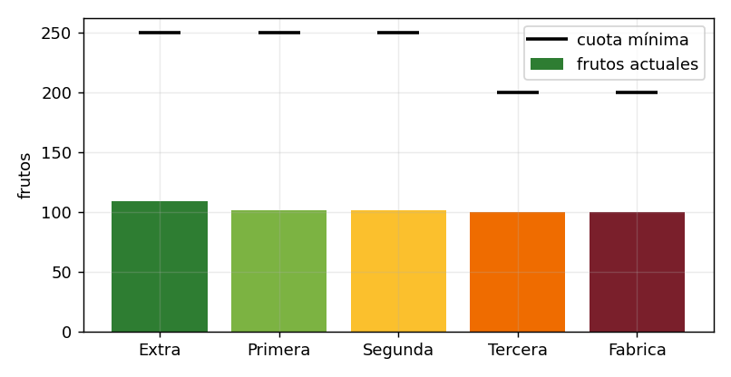
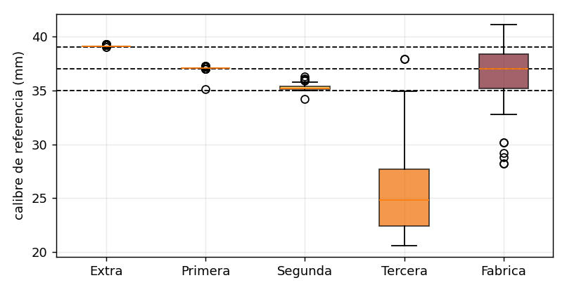
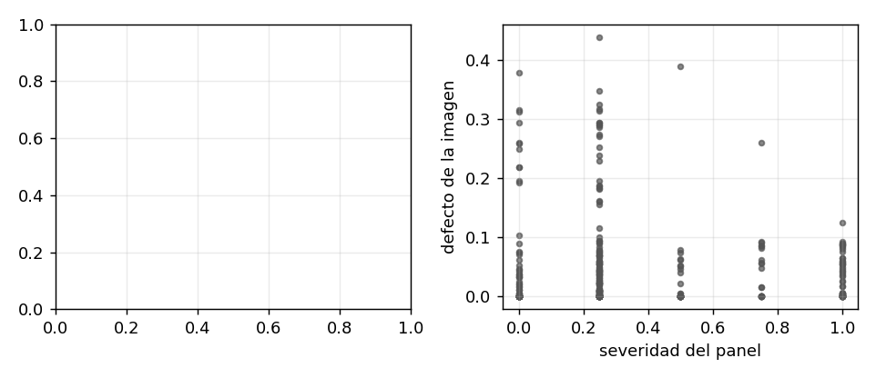
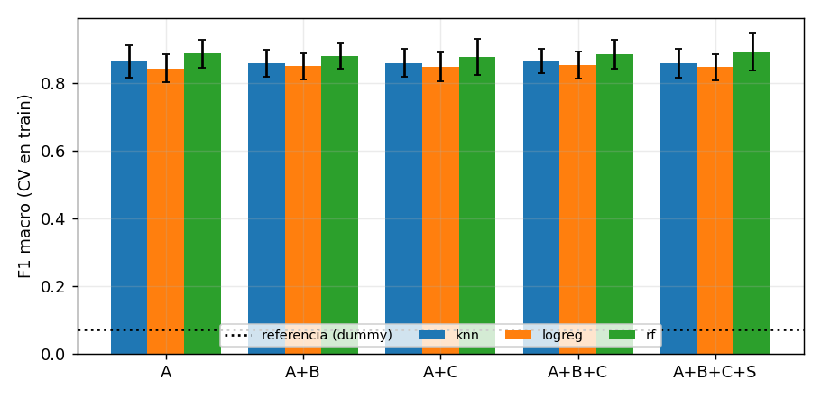
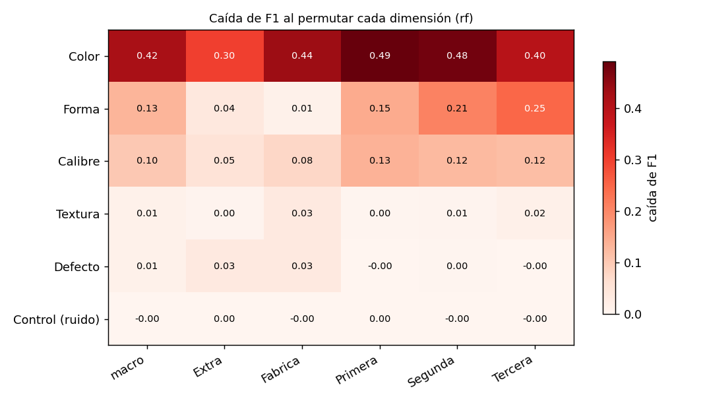
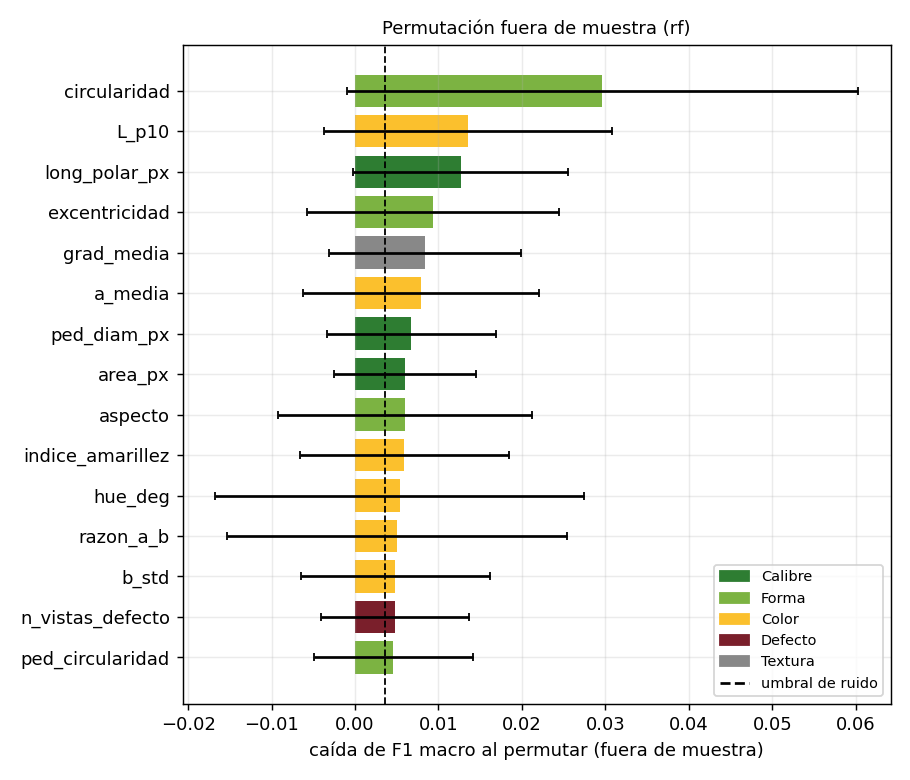
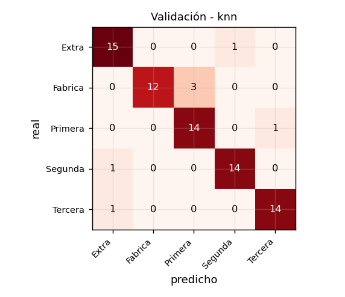
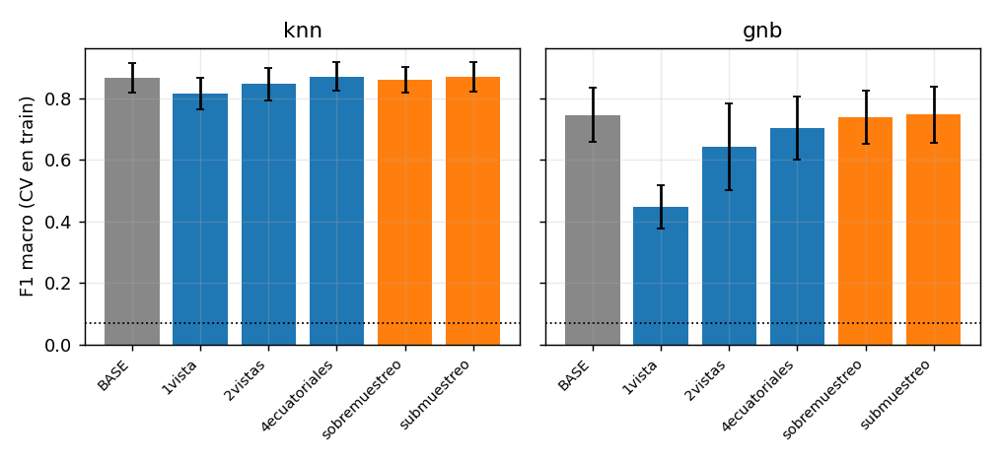
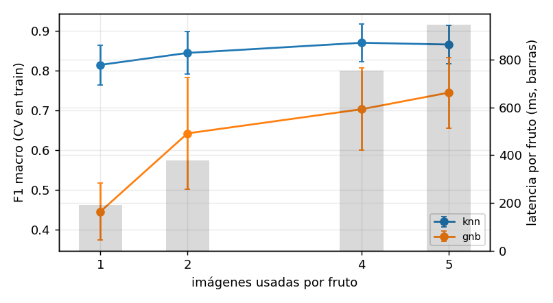

# Informe de avance: EDA, Feature Engineering y Baseline con variantes de datos

## 1. Resumen

- Datos: 511 frutos y 2555 imágenes; 5 de 5 categorías presentes; 3 lotes y 4 fechas.
- EDA: 0 capturas incompletas, 57 imágenes duplicadas, 0 muy borrosas y 4 etiquetas que contradicen el calibre.
- Cuotas mínimas: faltan frutos en Extra (141), Primera (149), Segunda (149), Tercera (100), Fabrica (100).
- Mejor configuración de FE por validación cruzada: A+B+C+S|rf (F1 macro 0.893 ± 0.054).
- Importancia de variables: la dimensión que más sostiene el F1 macro es Color (caída de 0.42 al permutarla).
- Baseline: knn con F1 macro 0.866 ± 0.048 frente a 0.071 de la referencia (clase mayoritaria).
- Variantes de datos: ninguna mostró una mejora estadísticamente demostrada sobre el baseline (Holm, α = 0,05); las diferencias observadas están dentro de la variabilidad entre pliegues.

## 2. Datos

*Frutos por categoría frente a la cuota mínima.*

| Categoría | Frutos | Cuota mínima | Faltan | Cumple | % |
|---|---|---|---|---|---|
| Extra | 109 | 250 | 141 | No | 21.3 |
| Primera | 101 | 250 | 149 | No | 19.8 |
| Segunda | 101 | 250 | 149 | No | 19.8 |
| Tercera | 100 | 200 | 100 | No | 19.6 |
| Fabrica | 100 | 200 | 100 | No | 19.6 |

*Figura 1. Frutos por categoría y cuota mínima.*

Unidad de análisis: el fruto (5 imágenes: 4 ecuatoriales y 1 de pedúnculo). Variable objetivo: categoría de referencia construida con calibre medido, evaluación ciega del panel y adjudicación. Lote y fecha solo agrupan; no son entradas del modelo.

## 3. Análisis exploratorio de datos (EDA)

### 3.1 Calidad de los datos

*Verificaciones de calidad de etiquetas e imágenes.*

| Verificación | Casos |
|---|---|
| frutos totales | 511 |
| id fruto duplicados | 0 |
| sin categoria ref | 0 |
| categoria invalida | 0 |
| sin calibre ref | 0 |
| calibre fuera de rango(25-60mm) | 52 |
| frutos sin imagenes | 0 |
| frutos sin etiqueta | 0 |
| capturas incompletas | 0 |

Imágenes: 0 ilegibles, 57 duplicadas exactas y 0 muy borrosas (nitidez atípicamente baja). Resoluciones: 564x1280, 705x1600, 720x1280, 747x1279, 756x1600, 818x1279, 824x1280, 830x1279, 849x1279, 864x1536, 900x1600, 960x1280, 1200x1600, 1600x900.

### 3.2 Calibre y consistencia con la categoría

*Figura 2. Calibre de referencia por categoría; líneas = umbrales de 35, 37 y 39 mm.*

Etiquetas no-Fábrica que contradicen su calibre: 4. Frutos fronterizos (a ±0,5 mm de un umbral): 343 (67.1 %); son los más sensibles al error de medición y exigen la mayor precisión del sistema.

### 3.3 Cobertura y riesgo de atajos

V de Cramér entre categoría y lote = 1.00; entre categoría y fecha = 1.00 (0 = independiente, 1 = totalmente asociado). Valores altos indicarían que el contexto de captura predice la categoría (atajo).

*Brillo, nitidez y saturación medios por lote (diferencias grandes = iluminación distinta entre sesiones).*

| Lote | Brillo | Nitidez | Saturación |
|---|---|---|---|
| L1 | 163.2 | 103.6 | 29.0 |
| L2 | 162.2 | 17.8 | 39.4 |
| L3 | 162.3 | 13.1 | 27.2 |

### 3.4 Hallazgos y acciones

*Hallazgos del EDA y acciones.*

| Hallazgo | Casos | Acción propuesta |
|---|---|---|
| Imágenes duplicadas | 57 | Eliminar duplicados y verificar el proceso de captura. |
| Etiqueta contradice calibre | 4 | Revisar con el panel y remedir el calibre. |
| Cuotas sin cumplir | 639 | Recolección dirigida de las categorías deficitarias. |

## 4. Feature Engineering

Cada fruto se resume en 30 variables originales (geometría, color CIELAB sobre superficie sana, defectos, textura; agregadas por fruto: calibre = mediana de las vistas ecuatoriales, color = media, defecto = máximo de las 5 vistas) y 10 variables de dominio (croma, matiz, amarillez, distancia a los umbrales de calibre, entre otras). Las transformaciones con estado se ajustan solo con train dentro de un Pipeline.

### 4.1 Validación de la extracción

> No hay calibre en mm para validar: falta data/raw/calibracion_sesiones.csv o calibre_mm_ref.

*Figura 3. Validación de las variables extraídas contra el estándar de referencia.*

### 4.2 Partición congelada

*Frutos por subconjunto (partición por fruto, huella 225c47198258).*

| Categoría | Train | Val | Test |
|---|---|---|---|
| Extra | 77 | 16 | 16 |
| Primera | 71 | 15 | 15 |
| Segunda | 71 | 15 | 15 |
| Tercera | 70 | 15 | 15 |
| Fabrica | 70 | 15 | 15 |

### 4.3 Ablaciones de Feature Engineering

*Ablación A (originales), B (transformaciones), C (dominio), S (colinealidad): media ± desviación en CV sobre train.*

| Configuración | #var | CV F1 macro | CV recall Fábrica | Val F1 macro | Ajuste (s) |
|---|---|---|---|---|---|
| REF\|dummy | 28 | 0.071 ± 0.002 | 0.000 ± 0.000 | 0.070 | 0.0 |
| A\|knn | 28 | 0.866 ± 0.048 | 0.767 ± 0.116 | 0.908 | 0.01 |
| A+B\|knn | 45 | 0.861 ± 0.040 | 0.776 ± 0.129 | 0.908 | 0.02 |
| A+C\|knn | 35 | 0.860 ± 0.041 | 0.810 ± 0.137 | 0.921 | 0.01 |
| A+B+C\|knn | 57 | 0.866 ± 0.037 | 0.824 ± 0.126 | 0.922 | 0.04 |
| A+B+C+S\|knn | 50 | 0.859 ± 0.042 | 0.790 ± 0.106 | 0.922 | 0.2 |
| A\|logreg | 28 | 0.845 ± 0.041 | 0.810 ± 0.120 | 0.868 | 0.02 |
| A+B\|logreg | 45 | 0.851 ± 0.039 | 0.805 ± 0.116 | 0.894 | 0.04 |
| A+C\|logreg | 35 | 0.849 ± 0.042 | 0.838 ± 0.079 | 0.893 | 0.03 |
| A+B+C\|logreg | 57 | 0.854 ± 0.041 | 0.829 ± 0.089 | 0.908 | 0.06 |
| A+B+C+S\|logreg | 50 | 0.849 ± 0.039 | 0.814 ± 0.093 | 0.920 | 0.21 |
| A\|rf | 28 | 0.888 ± 0.041 | 0.833 ± 0.110 | 0.960 | 0.34 |
| A+B\|rf | 45 | 0.882 ± 0.037 | 0.838 ± 0.106 | 0.960 | 0.38 |
| A+C\|rf | 35 | 0.878 ± 0.053 | 0.852 ± 0.128 | 0.961 | 0.35 |
| A+B+C\|rf | 57 | 0.886 ± 0.043 | 0.881 ± 0.110 | 0.921 | 0.37 |
| A+B+C+S\|rf | 50 | 0.893 ± 0.054 | 0.895 ± 0.132 | 0.974 | 0.61 |
| A_sin_escala\|knn | 28 | 0.394 ± 0.043 | 0.243 ± 0.120 | 0.412 | 0.01 |
| A_sin_escala\|logreg | 28 | 0.720 ± 0.038 | 0.705 ± 0.168 | 0.734 | 1.1 |

*Figura 4. F1 macro por configuración de Feature Engineering.*

Control de fuga (añadir `lote` como entrada): logreg: A = 0.845 ± 0.041; A + lote = 0.938 ± 0.030 (Δ +0.093). rf: A = 0.888 ± 0.041; A + lote = 0.954 ± 0.025 (Δ +0.066). Una mejora clara sobre la desviación indicaría que el contexto predice la categoría.

### 4.4 Importancia de variables

Se combinan cuatro métodos que fallan de forma distinta: permutación fuera de muestra (en cada pliegue de la validación cruzada sobre train se mide cuánto cae el F1 macro al barajar una variable), permutación agrupada por dimensión (Calibre, Forma, Color, Defecto, Textura), impureza de Random Forest e información mutua. Se añade una columna aleatoria de control: una variable solo se considera informativa si supera claramente su importancia. No se usa el conjunto de prueba.

- Dimensión que más sostiene el F1 macro (rf): Color (caída de 0.42).
- Dimensión que más sostiene cada clase (caída de F1): Extra: Color (0.30); Fabrica: Color (0.44); Primera: Color (0.49); Segunda: Color (0.48); Tercera: Color (0.40).
- Variables individuales que se distinguen del ruido (superan el umbral del control y ayudan en >= 60 % de los pliegues): rf 15 de 35, logreg 12 de 35.
- Acuerdo entre métodos (correlación de Spearman de los rangos, promedio): 0.51.

*Figura 5. Caída de F1 (macro y por clase) al permutar juntas todas las variables de una dimensión.*

*Figura 6. Importancia por permutación fuera de muestra por variable (barras = media ± desviación; línea = umbral del control de ruido).*

*Diez variables mejor posicionadas por consenso de rangos (menor rango medio = más importante).*

| Variable | Dimensión | Perm. rf | Perm. logreg | Impureza RF | Info. mutua | Rango medio | Supera ruido |
|---|---|---|---|---|---|---|---|
| circularidad | Forma | 0.03 | 0.097 | 0.066 | 0.548 | 2.2 | sí |
| razon_a_b | Color | 0.005 | 0.028 | 0.079 | 0.628 | 6.2 | sí |
| L_p10 | Color | 0.014 | 0.036 | 0.051 | 0.43 | 7.2 | sí |
| a_std | Color | 0.004 | 0.087 | 0.041 | 0.529 | 8.2 | sí |
| ped_diam_px | Calibre | 0.007 | 0.054 | 0.045 | 0.409 | 8.5 | sí |
| indice_amarillez | Color | 0.006 | 0.062 | 0.028 | 0.622 | 9.0 | sí |
| a_media | Color | 0.008 | 0.039 | 0.035 | 0.387 | 10.5 | sí |
| b_std | Color | 0.005 | 0.082 | 0.047 | 0.324 | 10.8 | no |
| hue_deg | Color | 0.005 | 0.011 | 0.077 | 0.628 | 10.8 | no |
| grad_media | Textura | 0.008 | 0.043 | 0.032 | 0.324 | 11.5 | sí |

Lectura: la importancia por variable subestima la de las variables redundantes (p. ej. el calibre en píxeles y en milímetros, o el área: cada una se compensa con las demás); por eso se reporta también la importancia agrupada. Un cociente de redundancia (grupo / suma de individuales) mayor que 1 indica información compartida entre variables de la dimensión: Color 9.1, Forma 2.4, Calibre 4.0, Textura 1.1, Defecto 1.1. Una importancia alta no implica causalidad ni que la variable sea necesaria si hay otra equivalente.

### 4.5 Limitaciones conocidas

- El color no está corregido con la carta de color entre sesiones (preprocesamiento pendiente): el análisis de deriva por lote/fecha mide el efecto.
- La escala px→mm depende de calibracion_sesiones.csv; sin ella no hay calibre en mm.
- Los umbrales de color y defecto de las variables de dominio son valores de ejemplo hasta fijarlos con el panel en el piloto.
- La segmentación clásica asume fondo uniforme; con la carta de color cerca del fruto conviene usar las máscaras del modelo de segmentación.

## 5. Baseline

Referencia mínima antes de cualquier modelo complejo: clasificadores simples sobre las variables originales (A) con imputación por mediana y escalado. Modelos: referencia por clase mayoritaria (dummy), kNN (k = 5) y Naive Bayes gaussiano. Misma partición congelada y mismos pliegues que Feature Engineering; la validación cruzada usa solo train y el conjunto de prueba no se toca.

*Baseline: media ± desviación en validación cruzada (train) y F1 macro en validación.*

| Modelo | CV F1 macro | CV F1 Fábrica | CV recall Fábrica | CV PR-AUC Fábrica | Val F1 macro | Latencia (ms/fruto) |
|---|---|---|---|---|---|---|
| dummy | 0.071 ± 0.002 | 0.000 ± 0.000 | 0.000 ± 0.000 | 0.195 ± 0.001 | 0.070 | 945 |
| knn | 0.866 ± 0.048 | 0.863 ± 0.077 | 0.767 ± 0.116 | 0.947 ± 0.045 | 0.908 | 946 |
| gnb | 0.745 ± 0.089 | 0.758 ± 0.080 | 0.681 ± 0.080 | 0.864 ± 0.076 | 0.811 | 945 |

*Figura 7. Matriz de confusión en validación del mejor baseline.*

Métrica central: F1 macro (hipótesis de la tesis), acompañada del F1, recall y PR-AUC de la clase Fábrica, que es la crítica: un falso negativo envía un fruto defectuoso a una categoría comercial superior.

## 6. Variantes de datos

Se cambia el dato, no el modelo, y una sola cosa por vez. V1: número de imágenes por fruto (1, 2, 4 ecuatoriales y 5); las features se re-agregan usando solo esas vistas en todos los subconjuntos. V2: balanceo de clases en train (sobremuestreo y submuestreo aleatorios, aplicados solo dentro del ajuste para no contaminar validación).

*Variantes frente al baseline del mismo modelo. Δ = diferencia media pareada por pliegue; p = prueba t corregida para CV repetida con corrección de Holm.*

| Modelo | Variante | CV F1 macro | Δ F1 | p (Holm) | Veredicto | CV F1 Fábrica | Δ F1 Fáb. | Lat. (ms) |
|---|---|---|---|---|---|---|---|---|
| gnb | BASE | 0.745 ± 0.089 | - | - | referencia | 0.758 ± 0.080 | - | 945 |
| gnb | V1_1vista | 0.446 ± 0.071 | -0.299 | 0.000 | empeora | 0.553 ± 0.134 | -0.205 | 190 |
| gnb | V1_2vistas | 0.642 ± 0.141 | -0.102 | 0.266 | sin evidencia | 0.635 ± 0.115 | -0.123 | 377 |
| gnb | V1_4ecuatoriales | 0.703 ± 0.103 | -0.042 | 1.000 | sin evidencia | 0.699 ± 0.095 | -0.059 | 753 |
| gnb | V2_sobremuestreo | 0.739 ± 0.086 | -0.006 | 1.000 | sin evidencia | 0.748 ± 0.088 | -0.010 | 945 |
| gnb | V2_submuestreo | 0.746 ± 0.091 | +0.001 | 1.000 | sin evidencia | 0.761 ± 0.079 | +0.003 | 945 |
| knn | BASE | 0.866 ± 0.048 | - | - | referencia | 0.863 ± 0.077 | - | 946 |
| knn | V1_1vista | 0.815 ± 0.050 | -0.051 | 0.534 | sin evidencia | 0.843 ± 0.075 | -0.020 | 191 |
| knn | V1_2vistas | 0.845 ± 0.054 | -0.021 | 1.000 | sin evidencia | 0.858 ± 0.108 | -0.005 | 377 |
| knn | V1_4ecuatoriales | 0.870 ± 0.047 | +0.004 | 1.000 | sin evidencia | 0.886 ± 0.073 | +0.023 | 754 |
| knn | V2_sobremuestreo | 0.858 ± 0.042 | -0.008 | 1.000 | sin evidencia | 0.864 ± 0.079 | +0.000 | 946 |
| knn | V2_submuestreo | 0.868 ± 0.048 | +0.002 | 1.000 | sin evidencia | 0.869 ± 0.083 | +0.005 | 946 |

*Figura 8. F1 macro por variante (gris = baseline, azul = V1 vistas, naranja = V2 balanceo; línea punteada = referencia dummy).*

### 6.1 Número de vistas: precisión frente a costo

*Figura 9. F1 macro y latencia de extracción según las imágenes usadas por fruto.*

Usar 1 vista en lugar de 5 reduce la latencia de extracción de 945 a 190 ms por fruto (medida en esta máquina; solo la extracción de features). Si la precisión no cae de forma demostrable, menos vistas simplifican la captura; si cae, se justifica el protocolo multi-vista.

### 6.2 Balanceo de clases

El sobremuestreo duplica frutos minoritarios (solo en train); el submuestreo descarta frutos de las clases mayoritarias y reduce el entrenamiento a la cantidad de la clase más pequeña. Con clases de pocos frutos, ambos son inestables: priorizar la recolección dirigida antes que depender del remuestreo.

### 6.3 Cómo leer la comparación

Una diferencia solo se considera mejora si la prueba t corregida, con Holm, da p < 0,05. Los pliegues y semillas no son independientes, por lo que la prueba es aproximada y conservadora; con pocos frutos, diferencias de 0,05 a 0,10 en F1 son ruido. Para la comparación final entre sistemas, usar McNemar o bootstrap pareado sobre el conjunto de prueba.

## 7. Conclusiones y siguientes pasos

- Lectura automática (hechos a validar): V1_1vista (gnb) Δ F1 macro -0.299, empeora; V1_2vistas (gnb) Δ F1 macro -0.102, sin evidencia; V1_1vista (knn) Δ F1 macro -0.051, sin evidencia.
- Prioridad de datos: completar las categorías y cuotas faltantes antes de interpretar diferencias entre variantes.
- Implementar la corrección de color con la carta y el cálculo de mm_por_px por sesión.
- Entrenar el baseline profundo (MVCNN) y el pipeline multitarea sobre la misma partición para la comparación final.

> Interpretación del equipo: [completar con qué variante conviene conservar, por qué, y qué se hará con los hallazgos del EDA].

## 8. Reproducibilidad

*Elementos para repetir el análisis.*

| Elemento | Valor |
|---|---|
| Huella de la partición | 225c47198258 |
| Corrida de Feature Engineering | 20261030_183239 |
| Corrida de baseline | 20261030_183632 |
| Corrida de importancia | 20261030_184617 |
| Configuración (hash) | FE c68292e8562f \| baseline 2798c62b118e |
| Versiones | Python 3.11.9, scikit-learn 1.9.1, pandas 3.0.6 |
| Semillas / pliegues | 3 semillas x 5 pliegues |
| Comandos | ingesta.py → particion.py → extraer_features.py → fe_experimentos.py → modelo_baseline.py → informe.py |
