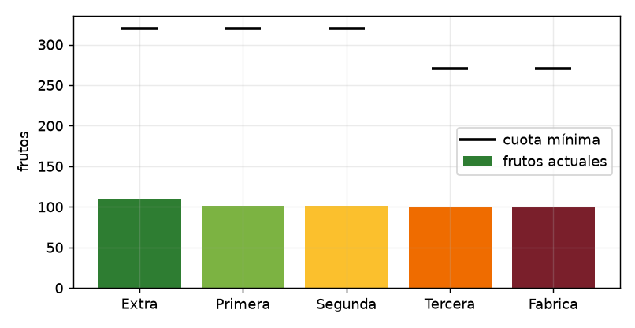
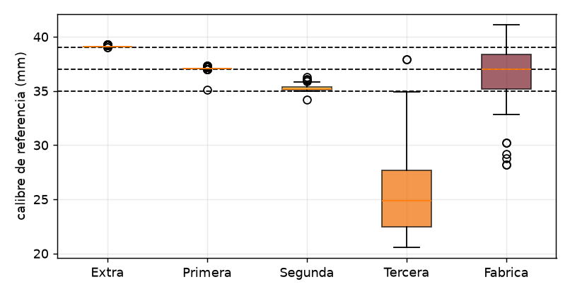
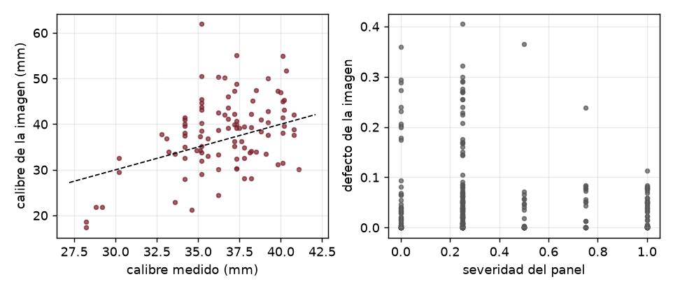
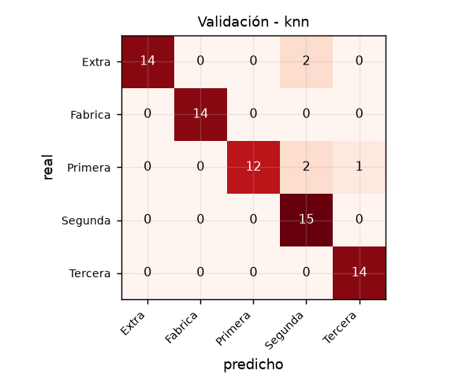
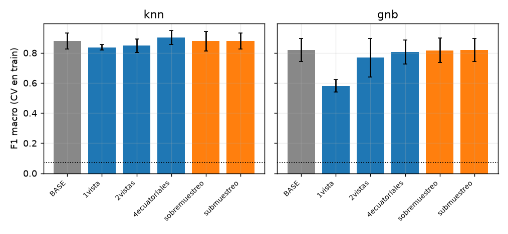
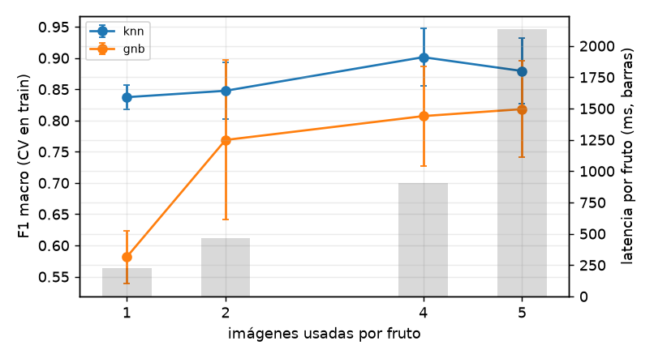

# Informe de avance: EDA, Feature Engineering y Baseline con variantes de datos

> **Se ignoró la última corrida de Feature Engineering (20261106_181415) porque se hizo con otra partición/otros datos. Vuelva a ejecutarla con los datos actuales.**

> **Se ignoró la última corrida de importancia de variables (20261106_190327) porque se hizo con otra partición/otros datos. Vuelva a ejecutarla con los datos actuales.**

## 1. Resumen

- Datos: 511 frutos y 2555 imágenes; 5 de 5 categorías presentes; 3 lotes y 4 fechas.
- EDA: 0 capturas incompletas, 57 imágenes duplicadas, 0 muy borrosas y 4 etiquetas que contradicen el calibre.
- Cuotas mínimas: faltan frutos en Extra (211), Primera (219), Segunda (219), Tercera (170), Fabrica (170).
- Feature Engineering: 30 variables originales y 10 de dominio; calibre extraído con MAE 5.65 mm (meta ≤ 1,0 mm) y sesgo +1.42 mm.
- Baseline: knn con F1 macro 0.879 ± 0.052 frente a 0.072 de la referencia (clase mayoritaria).
- Variantes de datos: ninguna mostró una mejora estadísticamente demostrada sobre el baseline (Holm, α = 0,05); las diferencias observadas están dentro de la variabilidad entre pliegues.
- Anexo A: matriz de consistencia (problema, objetivos, hipótesis, variables e indicadores) con el estado de la evidencia de cada hipótesis en este repositorio.

## 2. Datos

*Frutos por categoría frente a la cuota mínima.*

| Categoría | Frutos | Cuota mínima | Faltan | Cumple | % |
|---|---|---|---|---|---|
| Extra | 109 | 320 | 211 | No | 21.3 |
| Primera | 101 | 320 | 219 | No | 19.8 |
| Segunda | 101 | 320 | 219 | No | 19.8 |
| Tercera | 100 | 270 | 170 | No | 19.6 |
| Fabrica | 100 | 270 | 170 | No | 19.6 |

*Figura 1. Frutos por categoría y cuota mínima.*

Unidad de análisis: el fruto (5 imágenes: 4 ecuatoriales y 1 de pedúnculo). Variable objetivo: categoría de referencia construida con calibre medido, evaluación ciega del panel y adjudicación. Lote y fecha solo agrupan; no son entradas del modelo.

## 3. Análisis exploratorio de datos (EDA)

### 3.1 Calidad de los datos

*Verificaciones de calidad de etiquetas e imágenes.*

| Verificación | Casos |
|---|---|
| frutos totales | 511 |
| id fruto duplicados | 0 |
| sin categoria ref | 0 |
| categoria invalida | 0 |
| sin calibre ref | 0 |
| calibre fuera de rango(25-60mm) | 52 |
| frutos sin imagenes | 0 |
| frutos sin etiqueta | 0 |
| capturas incompletas | 0 |

Imágenes: 0 ilegibles, 57 duplicadas exactas y 0 muy borrosas (nitidez atípicamente baja). Resoluciones: 564x1280, 705x1600, 720x1280, 747x1279, 756x1600, 818x1279, 824x1280, 830x1279, 849x1279, 864x1536, 900x1600, 960x1280, 1200x1600, 1600x900.

### 3.2 Calibre y consistencia con la categoría

*Figura 2. Calibre de referencia por categoría; líneas = umbrales de 35, 37 y 39 mm.*

Etiquetas no-Fábrica que contradicen su calibre: 4. Frutos fronterizos (a ±0,5 mm de un umbral): 343 (67.1 %); son los más sensibles al error de medición y exigen la mayor precisión del sistema.

### 3.3 Cobertura y riesgo de atajos

V de Cramér entre categoría y lote = 1.00; entre categoría y fecha = 1.00 (0 = independiente, 1 = totalmente asociado). Valores altos indicarían que el contexto de captura predice la categoría (atajo).

*Brillo, nitidez y saturación medios por lote (diferencias grandes = iluminación distinta entre sesiones).*

| Lote | Brillo | Nitidez | Saturación |
|---|---|---|---|
| L1 | 163.2 | 103.6 | 29.0 |
| L2 | 162.2 | 17.8 | 39.4 |
| L3 | 162.3 | 13.1 | 27.2 |

### 3.4 Hallazgos y acciones

*Hallazgos del EDA y acciones.*

| Hallazgo | Casos | Acción propuesta |
|---|---|---|
| Imágenes duplicadas | 57 | Eliminar duplicados y verificar el proceso de captura. |
| Etiqueta contradice calibre | 4 | Revisar con el panel y remedir el calibre. |
| Cuotas sin cumplir | 989 | Recolección dirigida de las categorías deficitarias. |

## 4. Feature Engineering

Cada fruto se resume en 30 variables originales (geometría, color CIELAB sobre superficie sana, defectos, textura; agregadas por fruto: calibre = mediana de las vistas ecuatoriales, color = media, defecto = máximo de las 5 vistas) y 10 variables de dominio (croma, matiz, amarillez, distancia a los umbrales de calibre, entre otras). Las transformaciones con estado se ajustan solo con train dentro de un Pipeline.

### 4.1 Validación de la extracción

Calibre de la imagen frente al calibrador (n = 100): MAE 5.65 mm, RMSE 7.22 mm, sesgo +1.42 mm. Defecto de la imagen frente a la severidad del panel: Spearman = 0.16.

*Figura 3. Validación de las variables extraídas contra el estándar de referencia.*

### 4.2 Partición congelada

*Frutos por subconjunto (partición por fruto, huella cbd680356a79).*

| Categoría | Train | Val | Test |
|---|---|---|---|
| Extra | 68 | 16 | 25 |
| Primera | 61 | 15 | 25 |
| Segunda | 61 | 15 | 25 |
| Tercera | 61 | 14 | 25 |
| Fabrica | 61 | 14 | 25 |

### 4.3 Ablaciones de Feature Engineering

> Aún no se ejecutaron las ablaciones (o la última corrida es de otros datos): python src/fe_experimentos.py

### 4.4 Importancia de variables

> Aún no se calculó la importancia de variables (requiere >= 2 categorías): python src/importancia.py

### 4.5 Limitaciones conocidas

- El color no está corregido con la carta de color entre sesiones (preprocesamiento pendiente): el análisis de deriva por lote/fecha mide el efecto.
- La escala px→mm depende de calibracion_sesiones.csv; sin ella no hay calibre en mm.
- Los umbrales de color y defecto de las variables de dominio son valores de ejemplo hasta fijarlos con el panel en el piloto.
- La segmentación clásica asume fondo uniforme; con la carta de color cerca del fruto conviene usar las máscaras del modelo de segmentación.

## 5. Baseline

Referencia mínima antes de cualquier modelo complejo: clasificadores simples sobre las variables originales (A) con imputación por mediana y escalado. Modelos: referencia por clase mayoritaria (dummy), kNN (k = 5) y Naive Bayes gaussiano. Misma partición congelada y mismos pliegues que Feature Engineering; la validación cruzada usa solo train y el conjunto de prueba no se toca.

*Baseline: media ± desviación en validación cruzada (train) y F1 macro en validación.*

| Modelo | CV F1 macro | CV F1 Fábrica | CV recall Fábrica | CV PR-AUC Fábrica | Val F1 macro | Latencia (ms/fruto) |
|---|---|---|---|---|---|---|
| dummy | 0.072 ± 0.002 | 0.000 ± 0.000 | 0.000 ± 0.000 | 0.195 ± 0.006 | 0.071 | 2132 |
| knn | 0.879 ± 0.052 | 0.942 ± 0.068 | 0.897 ± 0.109 | 0.981 ± 0.039 | 0.934 | 2133 |
| gnb | 0.818 ± 0.077 | 0.984 ± 0.020 | 1.000 ± 0.000 | 1.000 ± 0.000 | 0.877 | 2132 |

*Figura 7. Matriz de confusión en validación del mejor baseline.*

Métrica central: F1 macro (hipótesis de la tesis), acompañada del F1, recall y PR-AUC de la clase Fábrica, que es la crítica: un falso negativo envía un fruto defectuoso a una categoría comercial superior.

## 6. Variantes de datos

Se cambia el dato, no el modelo, y una sola cosa por vez. V1: número de imágenes por fruto (1, 2, 4 ecuatoriales y 5); las features se re-agregan usando solo esas vistas en todos los subconjuntos. V2: balanceo de clases en train (sobremuestreo y submuestreo aleatorios, aplicados solo dentro del ajuste para no contaminar validación).

*Variantes frente al baseline del mismo modelo. Δ = diferencia media pareada por pliegue; p = prueba t corregida para CV repetida con corrección de Holm.*

| Modelo | Variante | CV F1 macro | Δ F1 | p (Holm) | Veredicto | CV F1 Fábrica | Δ F1 Fáb. | Lat. (ms) |
|---|---|---|---|---|---|---|---|---|
| gnb | BASE | 0.818 ± 0.077 | - | - | referencia | 0.984 ± 0.020 | - | 2132 |
| gnb | V1_1vista | 0.581 ± 0.043 | -0.237 | 0.001 | empeora | 0.989 ± 0.018 | +0.005 | 222 |
| gnb | V1_2vistas | 0.769 ± 0.128 | -0.049 | 1.000 | sin evidencia | 0.984 ± 0.020 | +0.000 | 465 |
| gnb | V1_4ecuatoriales | 0.807 ± 0.080 | -0.011 | 1.000 | sin evidencia | 0.984 ± 0.020 | +0.000 | 902 |
| gnb | V2_sobremuestreo | 0.817 ± 0.081 | -0.001 | 1.000 | sin evidencia | 0.984 ± 0.020 | +0.000 | 2132 |
| gnb | V2_submuestreo | 0.820 ± 0.076 | +0.001 | 1.000 | sin evidencia | 0.984 ± 0.020 | +0.000 | 2132 |
| knn | BASE | 0.879 ± 0.052 | - | - | referencia | 0.942 ± 0.068 | - | 2133 |
| knn | V1_1vista | 0.837 ± 0.020 | -0.042 | 1.000 | sin evidencia | 0.926 ± 0.054 | -0.016 | 224 |
| knn | V1_2vistas | 0.848 ± 0.046 | -0.032 | 1.000 | sin evidencia | 0.923 ± 0.048 | -0.019 | 466 |
| knn | V1_4ecuatoriales | 0.901 ± 0.046 | +0.022 | 1.000 | sin evidencia | 0.940 ± 0.051 | -0.002 | 903 |
| knn | V2_sobremuestreo | 0.878 ± 0.064 | -0.001 | 1.000 | sin evidencia | 0.945 ± 0.067 | +0.003 | 2134 |
| knn | V2_submuestreo | 0.879 ± 0.053 | +0.000 | 1.000 | sin evidencia | 0.939 ± 0.068 | -0.003 | 2134 |

*Figura 8. F1 macro por variante (gris = baseline, azul = V1 vistas, naranja = V2 balanceo; línea punteada = referencia dummy).*

### 6.1 Número de vistas: precisión frente a costo

*Figura 9. F1 macro y latencia de extracción según las imágenes usadas por fruto.*

Usar 1 vista en lugar de 5 reduce la latencia de extracción de 2133 a 223 ms por fruto (medida en esta máquina; solo la extracción de features). Si la precisión no cae de forma demostrable, menos vistas simplifican la captura; si cae, se justifica el protocolo multi-vista.

### 6.2 Balanceo de clases

El sobremuestreo duplica frutos minoritarios (solo en train); el submuestreo descarta frutos de las clases mayoritarias y reduce el entrenamiento a la cantidad de la clase más pequeña. Con clases de pocos frutos, ambos son inestables: priorizar la recolección dirigida antes que depender del remuestreo.

### 6.3 Cómo leer la comparación

Una diferencia solo se considera mejora si la prueba t corregida, con Holm, da p < 0,05. Los pliegues y semillas no son independientes, por lo que la prueba es aproximada y conservadora; con pocos frutos, diferencias de 0,05 a 0,10 en F1 son ruido. Para la comparación final entre sistemas, usar McNemar o bootstrap pareado sobre el conjunto de prueba.

## 7. Conclusiones y siguientes pasos

- Lectura automática (hechos a validar): V1_1vista (gnb) Δ F1 macro -0.237, empeora; V1_2vistas (gnb) Δ F1 macro -0.049, sin evidencia; V1_1vista (knn) Δ F1 macro -0.042, sin evidencia.
- Prioridad de datos: completar las categorías y cuotas faltantes antes de interpretar diferencias entre variantes.
- Implementar la corrección de color con la carta y el cálculo de mm_por_px por sesión.
- Entrenar el clasificador directo (ResNet-50, 5 vistas) y la segmentación del sistema híbrido sobre la misma partición para la comparación final (python src/experimentos.py).

> Interpretación del equipo: [completar con qué variante conviene conservar, por qué, y qué se hará con los hallazgos del EDA].

## 8. Reproducibilidad

*Elementos para repetir el análisis.*

| Elemento | Valor |
|---|---|
| Huella de la partición | cbd680356a79 |
| Corrida de Feature Engineering | - |
| Corrida de baseline | 20261112_220947 |
| Corrida de importancia | - |
| Configuración (hash) | FE - \| baseline 2798c62b118e |
| Versiones | Python 3.11.9, scikit-learn 1.9.1, pandas 3.0.6 |
| Semillas / pliegues | 3 semillas x 5 pliegues |
| Comandos | ingesta.py → particion.py → extraer_features.py → fe_experimentos.py → modelo_baseline.py → informe.py |

## Anexo A. Matriz de consistencia

**Proyecto:** Sistema de visión por computadora basado en deep learning para la clasificación comercial post-cosecha del limón sutil en cinco categorías  
**Autores:** Angel Joel Alvarado Crisanto · Javier Fernandez Purizaca  
**Asesora:** Ph.D. Glen Dario Rodriguez Rafael

*Fuente: Plan de tesis v4 (Tabla A1; hipótesis en la sección 3.3, variables en la Tabla 3.7 y ablaciones E1 a E5 en la Tabla 4.4). Los umbrales de la rúbrica (a1-a3, θ_def, h_am, p_am) son provisionales hasta ratificarlos tras la prueba piloto.*

| Problema | Objetivos | Hipótesis | Variables (independientes y dependientes) | Indicadores |
|---|---|---|---|---|
| **GENERAL** | | | | |
| **Problema general** ¿En qué medida un sistema de visión por computadora con arquitectura híbrida (segmentación neuronal, estimación analítica de calibre y color, y regla jerárquica explicable) alcanza un desempeño de clasificación comercial post-cosecha del limón sutil, medido por el F1 macro frente a un estándar de referencia independiente, y cómo se compara con un clasificador directo y con operarios en ejercicio? | **Objetivo general** Desarrollar y evaluar experimentalmente un sistema de visión por computadora con arquitectura híbrida para la clasificación comercial post-cosecha del limón sutil en cinco categorías, estimando su F1 macro frente a un estándar de referencia independiente y comparándolo con el de un clasificador directo y con el de operarios en ejercicio, en condiciones controladas. | **Hipótesis general** El sistema de visión por computadora con arquitectura híbrida alcanza un F1 macro ≥ 0,85 (límite inferior del IC del 95 %, bootstrap por fruto) en la clasificación comercial del limón sutil, en un conjunto de prueba independiente y en condiciones controladas. Las comparaciones con el clasificador directo y con operarios se contrastan en H3 y H4. | **Var. independiente(s):** • Arquitectura del sistema: clasificador directo (ResNet-50, 5 vistas) frente a híbrida (segmentación neuronal + atributos analíticos + regla jerárquica) • Preprocesamiento de brillo y color: ninguno; corrección de brillo; corrección de brillo y color • Estrategia de balanceo: ninguna; pesos de clase; focal loss; aumento dirigido; combinación • Número de vistas por fruto: 1 vista ecuatorial (0°) frente a 5 vistas (0°, 90°, 180°, 270° y pedúnculo) • Condición de iluminación: controlada o con cambio moderado **Var. dependiente(s):** • Categoría comercial final: F1 macro, exactitud balanceada, recall por clase (en particular Fábrica), kappa • Calibre estimado: MAE y RMSE en mm; acuerdo de categoría por calibre • Segmentación y defectos: IoU, Dice, AP de máscara, sensibilidad por tipo de defecto • Rendimiento y estabilidad: latencia mediana y percentil 95; porcentaje de frutos que conservan categoría **Var. interviniente(s):** • Lote, fecha y prevalencia • Fiabilidad del panel (kappa inter-evaluador y repetibilidad) • Tiempo entre cosecha y captura • Variabilidad de operarios (experiencia y turno; tiempo por fruto) | • F1 macro ≥ 0,85 (límite inferior del IC95 %, bootstrap estratificado B = 5 000) • Técnica: segmentación neuronal (YOLOv8-seg) + calibre y color analíticos + regla jerárquica |
| **ESPECÍFICOS** | | | | |
| P1. ¿Cuál es el MAE (mm) de la segmentación calibrada frente al calibrador vernier, y qué concordancia de categoría por calibre se obtiene, incluidos los frutos cercanos a los límites? | OE1. Determinar la precisión métrica del calibre estimado, cuantificando MAE y concordancia de categoría por calibre frente al vernier. | H1. La estimación de calibre por segmentación calibrada alcanza MAE ≤ 0,50 mm (límite superior del IC del 95 % ≤ 0,50), RMSE ≤ 0,70 mm (límite superior del IC ≤ 0,70) y exactitud dentro de una categoría adyacente ≥ 0,98; la concordancia exacta se reporta sin umbral. | **Var. independiente(s):** • Método de estimación del calibre: d_est = máx(media 0°/180°, media 90°/270°) con escala píxel-milímetro por sesión **Var. dependiente(s):** • Calibre: MAE y RMSE en mm; error cerca de los límites; exactitud en categoría adyacente | • MAE ≤ 0,50 mm; RMSE ≤ 0,70 mm; exactitud adyacente ≥ 0,98 • Error reportado en 34,5; 35; 36; 37; 38; 39 y 42 mm • Análisis: Bland–Altman, MAE, RMSE y concordancia en los intervalos críticos; bootstrap por fruto |
| P2. ¿En cuántos puntos porcentuales aumenta el recall de Fábrica al pasar de una vista (0°) a cinco vistas agregadas, sobre los mismos frutos? | OE2. Evaluar el efecto de la captura multi-vista sobre el recall de Fábrica, comparando una vista (0°) con cinco vistas agregadas. | H2. La captura multi-vista incrementa en al menos 15 puntos porcentuales el recall de Fábrica respecto de una única vista ecuatorial (0°), sobre los mismos frutos de la prueba (límite inferior del IC del 95 % > 0; McNemar pareado con Holm). | **Var. independiente(s):** • Número de vistas por fruto: 1 vista ecuatorial (0°) frente a 5 vistas (E1) **Var. dependiente(s):** • Recall de Fábrica; sensibilidad por tipo de defecto (secundaria) | • Incremento ≥ 15 pp y límite inferior del IC95 % > 0 • Análisis: McNemar pareado exacto; diferencia de recall con IC por bootstrap pareado (E1) |
| P3. ¿Supera la arquitectura híbrida por atributos y regla jerárquica al clasificador directo end-to-end en F1 macro? | OE3. Comparar el F1 macro de la arquitectura híbrida con el del clasificador directo end-to-end, con las mismas particiones y datos. | H3. La arquitectura híbrida supera al clasificador directo en F1 macro (límite inferior del IC del 95 % de la diferencia, por bootstrap pareado, > 0; relevancia práctica si la diferencia es ≥ 0,05). | **Var. independiente(s):** • Arquitectura: clasificador directo (ResNet-50, 5 vistas, promedio de logits) frente a híbrida (E2) **Var. dependiente(s):** • Categoría final: F1 macro | • Diferencia de F1 macro (híbrido − directo): límite inferior del IC95 % > 0; diferencia puntual ≥ 0,05 = relevancia práctica • Análisis: bootstrap pareado estratificado (B = 5 000) con corrección de Holm |
| P4. ¿Es la concordancia (κ) del sistema frente al estándar de referencia no inferior (δ = 0,05) a la de operarios en ejercicio, evaluados de forma pareada? | OE4. Contrastar la no inferioridad del kappa del sistema respecto del de operarios en ejercicio (δ = 0,05), frente al estándar de referencia. | H4. El kappa del sistema no es inferior al promedio de los operarios: límite inferior del IC del 95 % de κ_sis − κ_op ≥ −0,05 (δ = 0,05). La no inferioridad no implica superioridad. | **Var. independiente(s):** • Evaluador: sistema frente a operarios en ejercicio (al menos tres), sobre los mismos frutos **Var. dependiente(s):** • Concordancia con el estándar de referencia (κ) **Var. interviniente(s):** • Variabilidad de operarios (experiencia y turno; tiempo por fruto) | • κ_sis − κ_op ≥ −0,05 (límite inferior del IC95 %) • Análisis: bootstrap pareado por fruto; comparaciones por operario secundarias (McNemar con Holm) |

### Trazabilidad con el repositorio

| Hipótesis / objetivo | Qué lo contrasta | Evidencia en el repositorio | Estado |
|---|---|---|---|
| Datos (Tabla 4.1 y sección 4.4) | Ingesta, EDA, cuotas, diversificación, partición por cuotas con prueba balanceada y lote reservado | src/ingesta.py, src/particion.py, src/eda.py | Parcial |
| Piloto (4.6.7) | κ de Fleiss y repetibilidad del panel, MAE, viabilidad de captura; congelamiento de umbrales | src/panel.py, src/piloto.py | Pendiente |
| H1 / OE1 | d_est, MAE/RMSE con IC bootstrap, exactitud adyacente, Bland–Altman y error en 34,5–42 mm | src/atributos.py, src/calibracion.py, src/contrastes.py | Parcial |
| H2 / OE2 (E1) | 1 vista (0°) frente a 5 vistas: recall de Fábrica, McNemar exacto y bootstrap pareado | src/experimentos.py (e1_multivista), src/inferir_hibrido.py | Pendiente |
| H3 / OE3 (E2) | Híbrido (YOLOv8-seg + atributos + regla) frente a ResNet-50 de 5 vistas | src/segmentacion.py, src/inferir_hibrido.py, src/entrenar_directo.py, src/contrastes.py | Pendiente |
| H4 / OE4 | Sistema frente a operarios: κ_sis − κ_op, no inferioridad con δ = 0,05 | src/operarios.py, src/estadistica.py, src/contrastes.py | Pendiente |
| Ablaciones exploratorias (E3, E4, E5) | Preprocesamiento, balanceo y perturbaciones de luminancia, solo con validación | src/preprocesamiento.py, src/entrenar_directo.py, src/experimentos.py | Pendiente |
| Hipótesis general | F1 macro ≥ 0,85 (límite inferior del IC95 %, bootstrap estratificado B = 5 000) sobre la prueba congelada | src/contrastes.py (contraste_general), src/protocolo.py | Pendiente |
| Potencia estadística (Anexo 2) | Simulación Monte Carlo reproducible con semillas fijas | src/potencia.py | Parcial |

### Observaciones de consistencia (para revisar con la asesora)

1. Alineación con el plan v4: HG + P1–P4, OE1–OE4 y H1–H4 se corresponden uno a uno. La versión anterior del repositorio usaba ocho hipótesis (H1–H8), una red multitarea y B = 1 000; todo eso quedó reemplazado.
2. Familias de contraste (sección 3.3): la hipótesis general se evalúa sola (α = 0,05) y {H1, H2, H3, H4} con corrección de Holm. Los tamaños de muestra se calcularon con el α nominal sin ajustar, por lo que la potencia efectiva de los contrastes más exigentes es algo menor.
3. Los experimentos E1 (H2) y E2 (H3) son confirmatorios; E3, E4 y E5 son exploratorios y se eligen solo con el conjunto de validación. La prueba se evalúa una sola vez con modelos y umbrales congelados (src/protocolo.py).
4. Tamaño de muestra: el plan exige 1 500 frutos válidos (Tabla 4.1). Con menos frutos la partición se marca PROVISIONAL (data/processed/particion_meta.json) y no sirve para la evaluación confirmatoria.
5. Escala píxel-milímetro: sin data/raw/calibracion_sesiones.csv el calibre en mm queda vacío y H1 no es medible (ver src/preprocesamiento.py: escalas_de_sesiones).
6. Diversificación (4.4): ninguna categoría puede provenir de un solo lote o fecha; ningún lote o fecha puede aportar más del 35 % de una categoría. Si no se cumple, la sesión puede predecir la categoría.
7. Los umbrales de la rúbrica (a1–a3, θ_def, h_am, p_am) se fijan con el panel en el piloto y se congelan antes de la recolección definitiva.
